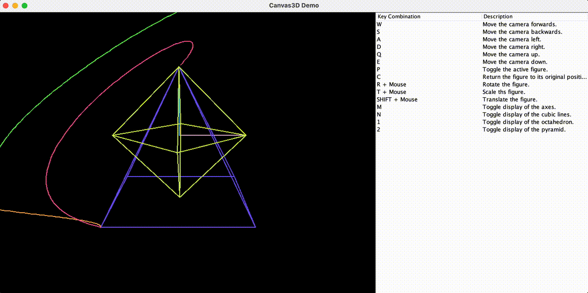

# 🌐 3D Canvas

**Author:** Nadezhda Grishina  
**Version:** 2023

---

## 🧩 Description

The **3D Canvas** project is a Java application that allows users to interactively manipulate 3D geometric shapes (pyramid and octahedron). It offers transformations like translation, rotation, and scaling, as well as projection switching between orthographic and perspective views.

This project is perfect for exploring 3D graphics, computer vision, and user interaction in Java.

---

## 🚀 Features

- 🎮 **Keyboard Controls:**
  - **W, A, S, D, Q, E** to move the camera forward, backward, left, right, up, and down.

- 🔄 **Toggle Active Figure:**
  - **P** to toggle between the pyramid and octahedron.

- 🔄 **Reset Figure Position:**
  - **C** to reset the selected figure to its original position.

- 🔧 **Transformations:**
  - **Rotation:** Press **R** and drag the mouse to rotate the figure.
  - **Scaling:** Press **T** and drag the mouse to scale the figure.
  - **Translation:** Hold **Shift** and drag the mouse to translate the figure.

- 🛠️ **Controls:**
  - **M** to toggle coordinate axes visibility.
  - **N** to toggle cubic lines visibility.
  - **1** to toggle the octahedron visibility.
  - **2** to toggle the pyramid visibility.
  - **Space** to toggle between orthographic and perspective projections.

---

## 🧰 Technologies Used

- Java 21
- Swing (Java AWT/Swing)
- Maven

---

> ✨ Live demo ↓



---

## 🛠️ Installation

1. Clone the repository:
   ```bash
   git clone https://github.com/nadyagrishina/3D-Canvas.git
2. Open in IntelliJ or another IDE

3. Run the `Driver` class

4. Make sure you have Java 21 installed

## 📚 Educational Attribution  
This project was developed as part of coursework at the University of Hradec Králové (UHK).  
It uses a base structure and some foundational classes provided by the Faculty of Informatics and Management for educational purposes.  
All additional code, logic, and extensions were implemented by the author.
